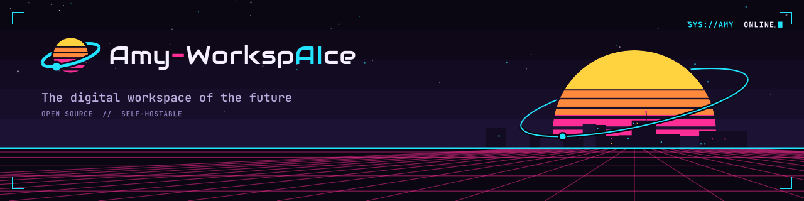

# Amy-WorkspAIce AI Platform

A self-hosted, customizable AI platform. It runs models on your own GPU, serves
them through an **OpenAI-compatible API**, and includes a web chat UI.

It is the first app of **[Amy-WorkspAIce](https://github.com/Amy-WorkspAIce)** ([brand](https://github.com/Amy-WorkspAIce/brand)), an
open-source workplace suite (documents, spreadsheets, tasks, notes, code, chat, ...).
Each app is its own container. The AI Platform is the AI service your other apps
call, and it can act on those apps through their APIs.

> **Status: early development.** Working today: a ChatGPT-style chat with saved history,
> web access, an agent mode that edits code and runs commands, image generation,
> speech-to-text and text-to-speech, hardware-aware model discovery with one-click installs,
> a multi-provider OpenAI-compatible API, bundled Ollama with NVIDIA GPU support, and
> API-key auth. See [Roadmap](#roadmap).

## Features

- **One conversation does everything.** Ask in chat and Amy delegates: "generate a photo of
  a cabin in the snow" → an image appears; "make it nighttime" → it edits that image;
  "turn it into a short video" → a clip renders in the background; "read that aloud" → audio.
  Attach your own images to edit, or audio files to transcribe. It searches the web when a
  question needs current information. Everything created lands in your **Library**.
- **Auto picks the model.** Leave the chat box on Auto and each message goes to the right
  model: coding questions and workspace tasks to your coding model, everything else to your
  chat model. Settings shows which ones it uses, and you can pin your own.
- **Rules**, like Cursor's: standing instructions for everywhere, one folder or one
  workspace ("when creating PRs, never force-push"). Folders and workspaces inherit the rules
  for everywhere and can switch any of them off. A rule can have Amy ask other models with
  the `ask_models` tool before answering, and a workspace's `AGENTS.md`, `CLAUDE.md` or
  `.cursor/rules/` are followed automatically.

- **One container, zero config.** Bundled [Ollama](https://ollama.com) with CUDA.
- **Every model, rated for your hardware.** Browse the whole Ollama library plus image,
  video and speech models from Hugging Face (hundreds of families), organized by purpose,
  each rated for your GPU ("Runs on GPU", "Partial GPU", "Too large"). Sort by
  **Perfect match**: the most capable models that still run well on your machine. Curated
  picks per use case sit on top; one click installs anything, including the engine it needs.
  Gated models work with your Hugging Face token (Settings). Click a column to sort, filter to
  models that fit on your GPU, and manage what's installed on the **Installed** tab. Each
  model lists its known **limits**: content it refuses (or has no filter for), what its
  license forbids, and known weak spots.
- **ChatGPT-style chat** with saved conversations in collapsible folders (drag and drop),
  streaming, markdown, collapsible "thinking" for reasoning models, dictation (the mic button,
  with Whisper installed; browsers allow the microphone only over HTTPS or on localhost, so
  the container also serves HTTPS on port 8443) and read-aloud.
- **Voices page**: browse and preview every installed speech model's voices and pick the one
  Amy speaks with; add **your own voices** (record or upload a short sample to copy a voice, or
  describe one in words: "a calm older man with a deep voice"); and install ready-made ones
  from the **voice library** (hundreds of free-to-use samples). Every model that can copy or
  design voices picks them up. Search, sort and filter voices by language, gender, age, accent,
  region, style and collection; voices nothing is known about show as "Uncategorized". Each
  library voice says which of your models can speak it, and suggests models to install if none can.
- **Long-term memory**: Amy picks up facts about you as you chat ("🧠 Remembered: …"), even
  when you share them a few messages before asking it to remember, and brings the relevant
  ones into new conversations. It works with reasoning models too. The Memory page lets you search, edit,
  add and delete them, or switch memory off. Secrets are never stored.
- **Long chats just work**: old tool output is trimmed and the oldest messages are summarized
  automatically when a conversation outgrows the model's context window.
- **Web access**: the model can search the web through a built-in, private SearXNG
  (no setup; Brave or your own SearXNG optional) and read pages, citing its sources.
  Weather questions use [Open-Meteo](https://open-meteo.com) directly (free, no key).
- **Agent mode**: describe a feature and Amy works on it in a workspace (an empty folder
  or a cloned git repo). It reads code, edits files and runs tests and builds, asking your
  approval before each change or command.
- **Image and video generation**: FLUX.2 klein, SDXL, Z-Image Turbo, SD 1.5, any diffusers
  model from Hugging Face; Wan 2.1 and LTX-Video for clips (rendered as background jobs).
  Galleries for both. Plus **audio**: transcription (Whisper) and text-to-speech: Kokoro, plus
  Hugging Face voice models that need their own library, each installed into its own
  environment the first time: Chatterbox, XTTS, F5-TTS and E2-TTS, Qwen3-TTS (CustomVoice,
  VoiceDesign, Base), OmniVoice, VoxCPM2, Supertonic, KittenTTS, Kyutai TTS, Pocket TTS,
  Parler-TTS, MeloTTS, Sopro, Soprano, Zonos, NeuTTS, OuteTTS, IndexTTS 2, VibeVoice Realtime,
  VieNeu-TTS, Sesame CSM, MMS and Bark. The engines
  these need (PyTorch/diffusers, faster-whisper, ONNX) install themselves into `/data` the
  first time you install such a model, so the base image stays lean.
- **OpenAI-compatible API** at `/v1`: chat, images, transcriptions and speech. Point any
  OpenAI SDK or app at it.
- **Bring any engine.** Bundled Ollama, an external Ollama, llama.cpp server, vLLM,
  LM Studio, or hosted APIs. Models from all of them appear in one list, as
  `provider/model`.
- **Secure by default.** API key required, auto-generated on first start.
- **Runs anywhere.** Unraid template, Docker Compose, Docker Desktop (Windows/macOS), bare metal.

## Quick start

### Unraid

Install from Community Applications *(pending submission)*, or add the template
manually. See **[docs/install/unraid.md](docs/install/unraid.md)**.

### Docker (Linux, NVIDIA GPU)

```bash
docker run -d --name amy-ai-platform --gpus all \
  -p 8484:8484 -p 8443:8443 -v ./amy-data:/data \
  ghcr.io/amy-workspaice/ai-platform:latest

docker logs amy-ai-platform          # shows your API key
```

Then open **http://localhost:8484**, paste the key, and go to **Models** to install a
model that fits your hardware. No GPU? Leave out `--gpus all`. **https://localhost:8443**
is the same app over HTTPS (a self-signed certificate, so your browser warns once), which
browsers need before they'll let you use the microphone from another machine.

More options (compose, external Ollama, Windows/macOS):
[docs/install/docker.md](docs/install/docker.md) and [docs/install/other.md](docs/install/other.md).

### Use the API

```python
from openai import OpenAI

client = OpenAI(base_url="http://localhost:8484/v1", api_key="amy-...")
reply = client.chat.completions.create(
    model="ollama/llama3.2",
    messages=[{"role": "user", "content": "Hello!"}],
)
print(reply.choices[0].message.content)
```

## Image variants

| Tag | Contents | Use when |
|---|---|---|
| `latest` | Platform + bundled Ollama + CUDA runtime (large) | Plug-and-play, especially on Unraid |
| `slim` | Platform only (small) | You already run Ollama, vLLM, etc. elsewhere |

## Documentation

- [Architecture](docs/architecture.md)
- [Configuration reference](docs/configuration.md)
- [API](docs/api.md)
- [Agent mode and web access](docs/agent-and-web.md)
- [Connectors: how other apps plug in](docs/connectors.md)
- [Development](docs/development.md)

## Roadmap

- [x] OpenAI-compatible proxy over multiple providers
- [x] Web chat with streaming
- [x] Bundled Ollama + NVIDIA GPU, Unraid template
- [x] Hardware-aware model discovery, one-click install with progress, delete
- [x] Saved conversation history (sidebar chat list)
- [x] Image generation (diffusers) and audio (faster-whisper, Kokoro) engines, installed on demand
- [x] Speech runtimes: Chatterbox, XTTS, F5-TTS, Qwen3-TTS, MMS and Bark, each in its own venv; gated GGUF models imported into Ollama with your Hugging Face token
- [x] Custom voices (recorded samples and described voices); Qwen3-TTS VoiceDesign and Base, OmniVoice, VoxCPM2
- [x] Voices page and voice library; 13 more speech engines (Supertonic, KittenTTS, Kyutai, Pocket TTS, Parler-TTS, MeloTTS, Sopro, Soprano, Zonos, NeuTTS, OuteTTS, IndexTTS 2, VibeVoice Realtime, VieNeu); built-in HTTPS; voice filters
- [x] Web access (search + page reading) and agent mode with approvals
- [x] Open catalog (Ollama library + Hugging Face), Perfect-match sorting, Settings page with Hugging Face token
- [x] Video generation (Wan 2.1, LTX-Video, any diffusers video pipeline)
- [x] Chat as the single interface: delegates images, edits, video and speech to specialist models; Library for results
- [x] Chat folders, long-term memory (Memory page), automatic context management
- [x] Brand identity (dark-first theme, Orbit logo), Installed models tab, sortable model table with GPU-fit filter, weather tool
- [x] Auto model routing (chat vs coding defaults), Rules (everywhere, per folder, per workspace) with a model panel tool
- [ ] Image-to-video
- [ ] Sandbox container for agent commands
- [ ] Provider management in the UI
- [ ] Multiple API keys and users
- [ ] Customization: personas/system prompts, themes, plugins
- [ ] Connectors: use other Amy-WorkspAIce apps (and any MCP server) as tools
- [ ] Embeddings API, RAG

## Contributing

See [CONTRIBUTING.md](CONTRIBUTING.md).

## License

[AGPL-3.0-or-later](LICENSE). You may self-host, modify, and redistribute it. If you
offer a modified version to users over a network, you must publish your changes.
